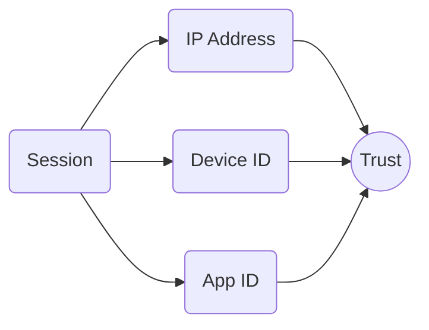

## What This Is

Every application working with Telegram API has a pair of identifiers: **App ID** (number) and **API Hash** (string). Telegram sees them on every connection and considers them in session evaluation.

## Where Keys Come From

### Official Clients

Keys can be extracted from source code or binaries of popular clients:

| Client | App ID | API Hash |
|--------|--------|----------|
| Telegram Android | `6` | `eb06d4abfb49dc3eeb1aeb98ae0f581e` |
| Telegram iOS (Beta) | `8` | `7245de8e747a0d6fbe11f7cc14fcc0bb` |
| Telegram Desktop (Windows Beta) | `2040` | `b18441a1ff607e10a989891a5462e627` |
| Telegram macOS (Beta) | `2834` | `68875f756c9b437a8b916ca3de215815` |
| Telegram X | `21724` | `3e0cb5efcd52300aec5994fdfc5bdc16` |
| Android Beta | `4` | `014b35b6184100b085b0d0572f9b5103` |
| Static Final | `5` | `1c5c96d5edd401b1ed40db3fb5633e2d` |
| Unknown Beta | `9` | `3975f648bb682ee889f35483bc618d1c` |

Official client keys have better reputation because regular people use them for regular communication.

<Note>
Use keys matching your platform. Android keys for Android devices, Desktop keys for computers.
</Note>

### Libraries

Popular libraries come with built-in keys:

| Library | Situation |
|---------|-----------|
| Telethon | Built-in keys, used by default |
| Pyrogram | Built-in keys, used by default |
| TDLib | Requires you to specify your own |

**Problem:** library built-in keys are public. A huge number of people use them for various purposes, including spammers. The reputation of such keys is lower than official client keys.

### Your Own

You can create them at my.telegram.org. Fresh keys have no history, which can be both a plus (no negative) and a minus (no positive).

## How App ID Affects Trust

App ID participates in forming session trust along with IP and Device ID.

Telegram accumulates statistics for each App ID:
- How many accounts use it
- What percentage got spamblocks
- Were there mass complaints
- Nature of activity

## Interesting Details

### Platform Must Match

When creating an App ID, a platform is specified: Android, iOS, Desktop, Web. Telegram checks the declared platform against actual session data.

Mismatch raises suspicion:
- App ID with platform "iOS", but User-Agent from Android
- App ID "Desktop", but mobile fingerprint

So if you extract keys from a client, use them on the corresponding platform.

### Link to Creator

App ID is forever linked to the account that created it. If the creator account is blocked for serious violations, this may affect the reputation of all its App IDs.

### Usage Patterns

Telegram sees how many different accounts use one App ID. By itself this is normal (official clients work this way), but combined with other factors it's considered.

"One App ID + one IP + many accounts" is more suspicious than "official App ID + different IPs + many accounts".

## What to Choose

<CardGroup cols={2}>
<Card title="Official Client Keys" icon="check" color="#22c55e">
Best choice for most cases. High reputation, platform match.
</Card>

<Card title="Built into Libraries" icon="minus" color="#6b7280">
Work, but worse reputation. Fine if there are no problems.
</Card>

<Card title="Your Own" icon="plus" color="#6b7280">
Clean history. Makes sense for large projects.
</Card>

<Card title="Others' from Internet" icon="ban" color="#ef4444">
Don't use. Unknown history, possibly compromised.
</Card>
</CardGroup>

## Factor Priority

App ID is important, but not determining:

1. **IP address** — the most important factor
2. **Account history** — previous violations
3. **Device ID** — connection to other accounts
4. **App ID** — additional signal

Good IP and clean history outweigh not the best App ID. But all else being equal, it's better to use official client keys.

## Next Steps

<CardGroup cols={2}>

<Card title="Supported Clients" icon="smartphone" color="#6b7280" href="/en/getting-started/supported-clients" arrow="true">
  Which clients to use for login.
</Card>

<Card title="Environment" icon="settings" color="#6b7280" href="/en/accounts/env" arrow="true">
  Device ID and other environment parameters.
</Card>

</CardGroup>
