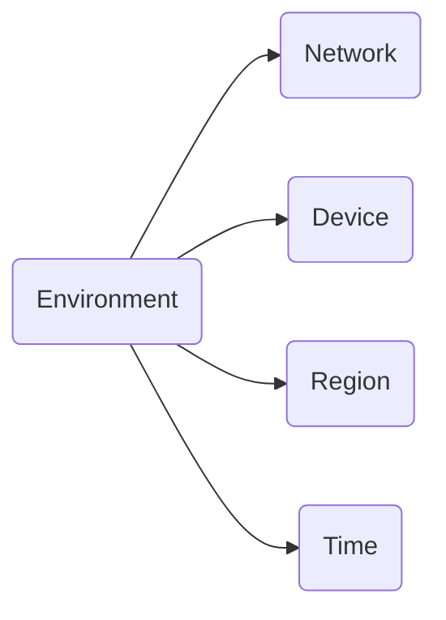

## What is Environment

Environment is everything Telegram sees when connecting: network, device, region, time. These parameters form the session context.

<CardGroup cols={2}>

<Card title="Network" icon="wifi">
  - IP address
  - Provider
  - Connection type
</Card>

<Card title="Device" icon="smartphone">
  - Operating system
  - Model
  - Client version
</Card>

<Card title="Region" icon="map-pin">
  - Country
  - City
  - IP geolocation
</Card>

<Card title="Time" icon="clock">
  - Timezone
  - Activity hours
</Card>

</CardGroup>

## Consistency

Telegram compares all parameters with each other. If they point to one region, everything is fine. If they contradict, questions arise.

| Situation | Example | Risk |
|-----------|---------|------|
| Everything matches | Number +7, IP from Russia, time MSK | Minimal |
| Small deviation | Number +7, IP from Russia, English language | Low |
| Different regions | Number +7, IP from USA | High |
| Teleportation | Moscow at 10:00, Tokyo at 10:05 | Critical |

<Note>
The key factor is plausibility. Gradual movement from Russia to Germany over a week is normal. A jump in 5 minutes is not.
</Note>

## What to Configure

Before logging into an account, check:

| Parameter | What's needed |
|-----------|---------------|
| IP address | From the phone number's region. |
| IP type | Quality proxy (not VPN). |
| Timezone | Matches the IP region. |
| System language | Preferably matches the region. |

<Warning>
If the IP is bad (datacenter, known VPN, blacklisted), Telegram may require purchasing Premium to continue. This is a signal to change your proxy.
</Warning>

## Device ID

Device ID is a unique device identifier. Telegram assigns it on first login based on characteristics: model, OS, client version.

### What Telegram Checks

- Whether you've logged in from this device before.
- What other accounts have logged in from this device.
- How often accounts change.

### Why This Matters

Many accounts from one Device ID = sign of multi-accounting. Same with IP: if multiple accounts use one proxy, Telegram links them together.

Consequences:

- Frequent verification requests.
- Feature restrictions.
- Account blocks.
- Problem with one account affects others.

<Note>
Different accounts — different proxies. Using one proxy for multiple accounts is risky.
</Note>

### Limits

<Note>
Maximum 5 accounts per device. Activity from all is summed: a problem with one account affects the trust of others.
</Note>

| Count | Comment |
|-------|---------|
| 1-2 accounts | Safe. |
| 3-4 accounts | Acceptable, but lower trust. |
| 5 accounts | Maximum. Problem with one affects all. |

### How to Reset Device ID

Simply reinstalling Telegram doesn't reset Device ID. It's formed from a combination of:

- Hardware identifiers.
- OS parameters.
- Client data.

To change it, you need to change the entire environment: different device, virtual machine, or separate profile.

## Next Steps

<CardGroup cols={2}>

<Card title="Proxy" icon="globe" color="#6b7280" href="/en/network/proxy" arrow="true">
  How to choose and set up a proxy.
</Card>

<Card title="Troubleshooting" icon="circle-alert" color="#6b7280" href="/en/issues/troubleshooting" arrow="true">
  What to do with environment problems.
</Card>

</CardGroup>
