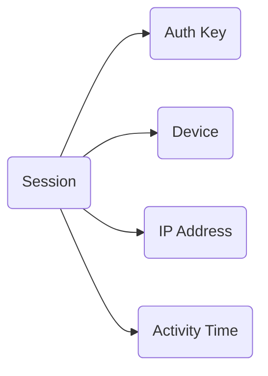
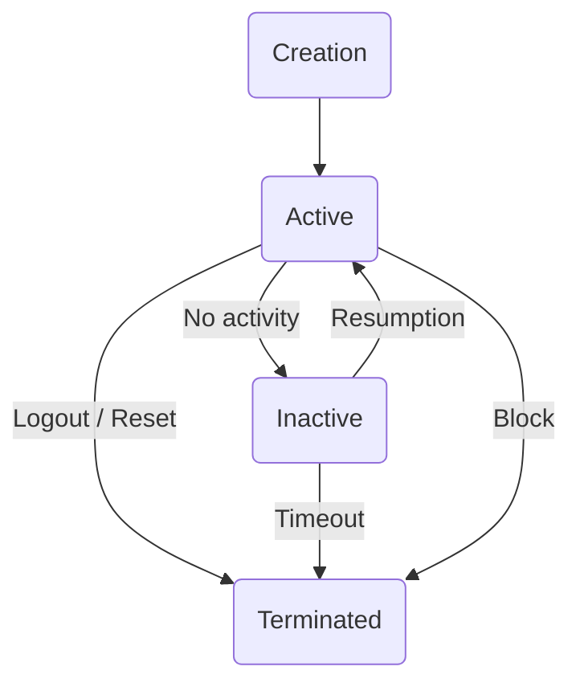

## What is a Session

A session is an authorized connection to an account from a specific device. When you log into Telegram, a session is created that allows you to use the account without re-entering the code.

One account can have multiple active sessions: phone, computer, web version.

## What a Session Contains

Each session contains:

- **Auth Key** — a cryptographic key for encrypting traffic. Generated once when the session is created.
- **Device Info** — information about the device (model, OS, client version).
- **IP Address** — the address from which the session was created and last activity.
- **Time** — when it was created and when there was last activity.

<Note>
Auth Key is the main thing. Whoever owns the key controls the session. That's why session files (.session) need to be kept secure.
</Note>

## Lifecycle

**Creation** — you enter the number, get the code, log in. Telegram creates a session.

**Active** — the session works, you use the account.

**Inactive** — you haven't logged in for a long time. The session is still alive, but Telegram may terminate it after several months.

**Terminated** — the session no longer works. Re-authorization is required.

## Why a Session May Drop

| Reason | What happens |
|--------|--------------|
| You clicked "Terminate session" | Session closes. |
| Reset all sessions | All devices are logged out. |
| Telegram detected an anomaly | Sudden IP/region change, suspicious activity. |
| Long inactivity | Telegram terminates inactive sessions (usually after 6 months). |
| Account blocked | All sessions are terminated. |

## Where to View Sessions

In Telegram: **Settings → Devices** (or **Settings → Privacy → Active Sessions**).

There you can see:

- All active sessions.
- Device and IP of each session.
- When the last activity was.

From there you can also terminate any session or all at once.

## Multiple Sessions at Once

Telegram allows multiple active sessions. This is normal:

- Main phone.
- Work computer.
- Tablet.

But if there are too many sessions or they're from different countries simultaneously — this raises suspicion.

<Note>
Sessions are independent of each other. If one is terminated or blocked, the others continue to work.
</Note>

## Next Steps

<CardGroup cols={2}>

<Card title="Environment" icon="globe" color="#6b7280" href="/en/accounts/env" arrow="true">
  How IP and region affect the session.
</Card>

<Card title="Troubleshooting" icon="triangle-alert" color="#6b7280" href="/en/issues/troubleshooting" arrow="true">
  What to do if a session drops.
</Card>

</CardGroup>
