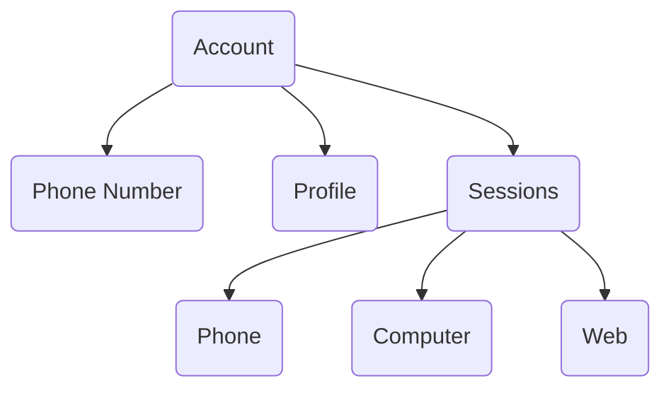

## How an Account Works

A Telegram account is not just a login and password. It's a combination of several components:

## Phone Number

The number is the main account identifier. It's used for:

- Logging into the account.
- Receiving verification codes.
- Recovering access.

The country code in the number (+7, +1, +49) also determines the account's "home" region. Telegram expects activity to be primarily from this region.

## Profile

The profile is the public part of the account:

- First and last name.
- Username (@username).
- Photo.
- Bio.

The profile can be changed without affecting account security.

## Sessions

A session is created every time you log into an account from a new device. One account can have multiple active sessions simultaneously.

Each session is linked to:

- Device (model, OS).
- IP address.
- Telegram client (version, platform).

Telegram tracks all sessions. You can view them in settings: **Settings → Devices**.

## Device ID

Each device gets a unique identifier — Device ID. Telegram remembers which devices have logged into an account and links accounts together.

<Note>
**Rule:** maximum 5 accounts per device, but fewer is better.
</Note>

More details about Device ID, limits, and reset — in the [Environment](/en/accounts/env#device-id) section.

## What's Important to Understand

<CardGroup cols={3}>

<Card title="Number = Account" icon="phone">
  Losing access to the number means losing the account.
</Card>

<Card title="Sessions Are Independent" icon="layers">
  A problem with one session doesn't affect others.
</Card>

<Card title="Region Matters" icon="map-pin">
  Telegram compares the number's country code with IP geolocation.
</Card>

</CardGroup>

## Next Steps

<CardGroup cols={2}>

<Card title="Sessions" icon="key" color="#6b7280" href="/en/accounts/sessions" arrow="true">
  More details on how sessions work.
</Card>

<Card title="Environment" icon="globe" color="#6b7280" href="/en/accounts/env" arrow="true">
  How to set up IP and region.
</Card>

</CardGroup>
