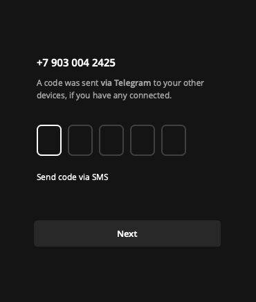

## Code Issues

<Warning>
The code is issued once. After you receive it, we log out of the account — it's completely yours. If you received the code but didn't enter it (closed Telegram, left the input field) — the code expires. You can't get it again, no refund is provided.
</Warning>

<Frame
    caption="At this moment you need to click the Get Code button on the website. Don't request the code before this moment."
>
  
</Frame>

**Why the code may not arrive:**

- **Bad IP** — datacenter, VPN, blacklisted IP
- **Suspicious device** — problematic accounts have used this Device ID
- **Region mismatch** — IP from one country, number from another

First try changing devices and proxies. If the code still doesn't appear — contact [@GetMyTGSUPbot](https://t.me/GetMyTGSUPbot).

## Spamblock

**Right after login.** Environment problem: bad IP (datacenter, VPN, blacklist) or mismatch between IP region and number. Check your IP, change proxy if needed.

**After activity.** User complaints, mass actions, or suspicious behavior. Check status via @SpamBot. Reduce activity and wait — most restrictions are lifted automatically after hours or days.

**Shadow ban.** Messages are sent but don't arrive. You don't see this. If people stopped replying — check @SpamBot.

## Requires Premium

Telegram requires Premium purchase on login — the IP is bad. This isn't a bug, it's spam protection. Switch to a residential or mobile proxy.

## Session Errors

**AUTH_KEY_UNREGISTERED.** Session is invalid. Need to log in again.

**SESSION_REVOKED.** Session was revoked (possibly from another device via "Terminate all sessions"). Need to log in again.

**Session keeps resetting.** IP changes during work, or proxy drops and traffic goes directly. Check proxy stability.

## Frequent Verification Requests

Telegram requests code too often — environment problem:

- IP is unstable or changing
- IP region doesn't match number region
- Device timezone doesn't match IP

## Quick Diagnostics

| Symptom | Cause | Solution |
|---------|-------|----------|
| Code not arriving | Went to another session | "Get Code" button on website |
| FLOOD_WAIT | Too many attempts | Wait the specified time |
| Spamblock after login | Bad IP | Change proxy |
| Requires Premium | Bad IP | Switch to residential/mobile |
| Session keeps resetting | Unstable IP | Check proxy |
| Frequent verification | Environment mismatch | Check region, timezone |
| AUTH_KEY_UNREGISTERED | Session died | Log in again |

## Nothing Helps

<Card title="Support" icon="message-circle" color="#6b7280" href="https://t.me/GetMyTGSUPbot" arrow="true">
  Contact us with a description of the problem and what you've already tried.
</Card>
