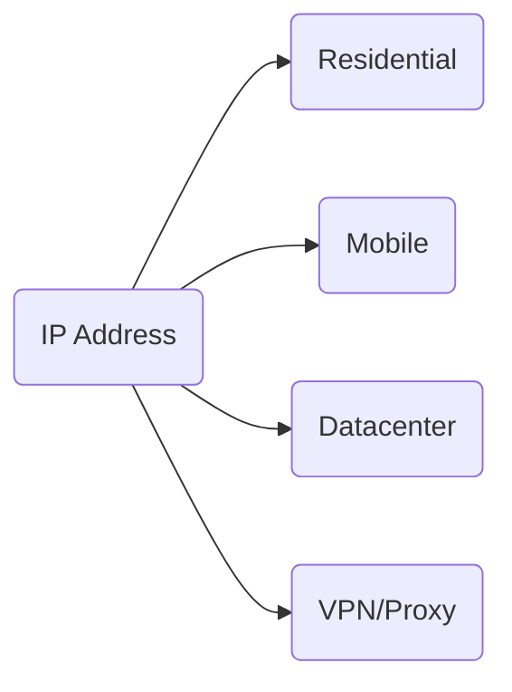

## What Telegram Analyzes

On every connection, Telegram sees:

- **IP address** and its geolocation.
- **Network type** (home provider, mobile carrier, datacenter).
- **IP reputation** (is it blacklisted).
- **Change history** (how often the IP changes).

## IP Address Types

### Residential IP

IP from a home internet provider. Issued to regular users.

| Parameter | Value |
|-----------|-------|
| Trust | High |
| Availability | Hard to get |
| Cost | High |

This is the best option for working with accounts.

### Mobile IP

IP from a mobile carrier. Often used by many users simultaneously (CGNAT).

| Parameter | Value |
|-----------|-------|
| Trust | Medium-high |
| Availability | Through mobile proxies |
| Cost | Medium |

Good option, especially for accounts with mobile numbers.

### Datacenter

IP from hosting providers and cloud services.

| Parameter | Value |
|-----------|-------|
| Trust | Low |
| Availability | Easy |
| Cost | Low |

Telegram easily identifies such IPs and treats them with suspicion.

### VPN Services

IPs from popular VPN providers.

| Parameter | Value |
|-----------|-------|
| Trust | Very low |
| Availability | Easy |
| Cost | Low |

Most IPs are known to Telegram and are blacklisted. [Why VPN doesn't work](/en/network/vpn).

## What Matters

<CardGroup cols={2}>

<Card title="Region = Number" icon="map-pin">
  IP should be from the same region as the account's phone number.
</Card>

<Card title="Stability" icon="anchor">
  Frequent IP changes raise suspicion. One IP for a long time is better than different ones every day.
</Card>

<Card title="Reputation" icon="shield-check">
  IP should not be blacklisted or marked as proxy/VPN.
</Card>

<Card title="One IP = One Account" icon="user">
  Using one IP for multiple accounts links them together.
</Card>

</CardGroup>

## Acceptable Scenarios

| Situation | Risk |
|-----------|------|
| Stable IP from number's region | Minimal |
| IP change within same provider | Low |
| City change within country | Low |
| Country change (gradually) | Medium |
| Frequent IP changes | High |
| Teleportation (Moscow → Tokyo in 5 minutes) | Critical |

<Note>
The key factor is plausibility. Changes should look like natural behavior of a regular user.
</Note>

## Next Steps

<CardGroup cols={2}>

<Card title="Why Not VPN" icon="shield-off" color="#6b7280" href="/en/network/vpn" arrow="true">
  Why VPN doesn't work for accounts.
</Card>

<Card title="Proxy" icon="globe" color="#6b7280" href="/en/network/proxy" arrow="true">
  How to choose and set up a proxy.
</Card>

</CardGroup>
