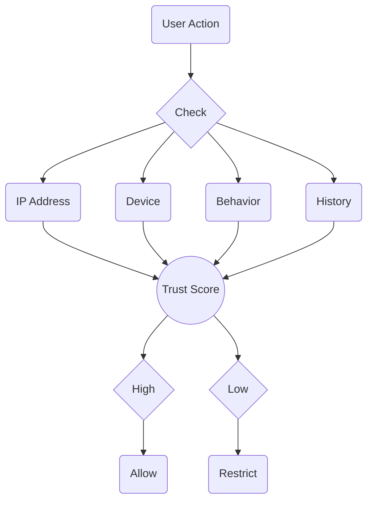

## Main Thing — Set Up 2FA

<Warning>
**This is the first thing you need to do after logging into an account.**

Accounts are registered to virtual numbers. Unscrupulous SMS providers may resell the number. Then the new owner will get the code and log into your account.

2FA protects against this: even with the SMS code, you can't log in without the password.
</Warning>

### How to Set Up

<Steps>
<Step title="Open Settings">
In Telegram, go to **Settings**.
</Step>

<Step title="Privacy">
Select **Privacy and Security**.
</Step>

<Step title="Two-Step Verification">
Tap **Two-Step Verification** and set a password.
</Step>

<Step title="Save the Password">
Write down the password in a safe place. If you forget it, recovering access will be difficult.
</Step>
</Steps>

<Note>
You can add an email for recovery, but it's optional. The main thing is the password itself.
</Note>

## Trust Score

Telegram maintains an internal trust rating for each account. It's not officially disclosed, but system behavior clearly indicates its existence.

### What Increases Trust

- Account age
- Stable environment (one IP, one device)
- No complaints
- 2FA enabled
- Natural activity patterns
- Gradual "warm-up" after purchase

### What Decreases Trust

- New account without history
- User complaints
- Spamblocks and restrictions in history
- Frequent IP or device changes
- Mass actions (broadcasts, invites)
- Mismatch between IP region and number

### Consequences of Low Trust

With low trust score, Telegram:

- Sets stricter limits
- Requests verification more often
- Issues spamblocks faster
- May require Premium for login from bad IP

## How Telegram Monitors Accounts

Telegram analyzes each action in context:

- **IP** — type, region, reputation
- **Device** — Device ID, how many accounts logged in from it
- **Behavior** — frequency, action types, timing
- **History** — were there problems before

## Basic Rules

<CardGroup cols={2}>

<Card title="Stability" icon="anchor">
Don't change IP, device, and region unnecessarily. Every change is a signal to Telegram.
</Card>

<Card title="Gradualness" icon="trending-up">
A new account needs to "warm up". Start with minimal activity, increase gradually.
</Card>

<Card title="Naturalness" icon="user">
Act like a regular user. Pauses between messages, variety of actions, human rhythm.
</Card>

<Card title="Attention to Signals" icon="bell">
FLOOD_WAIT, verification requests, spamblocks — these are warnings. React immediately.
</Card>

</CardGroup>

## What to Avoid

- **Mass actions** — broadcasts, invites, adding contacts in batches
- **Sudden changes** — changing IP mid-session, moving between regions
- **Ignoring limits** — repeated requests after FLOOD_WAIT
- **Bad IPs** — VPN, datacenters, blacklisted IPs

## Non-Obvious Things

**First 48 hours.** A violation on a new session weighs much more. Follow the [warm-up period](/en/getting-started/overview#warm-up-period) — first days without active actions.

**Premium.** A spammer doesn't pay for a subscription. Telegram understands this and gives Premium accounts more freedom.

**Shadow ban.** Messages are sent but don't arrive. You don't see this. If people stopped replying, check @SpamBot.

**Timezone.** German proxy + Moscow time = mismatch. Telegram sees this.

**Empty profile.** Without photo and bio, the account looks like a spam dummy. But don't fill it out right away — let the account rest for 3-5 days, then add photo and bio.

**Username with history.** If the username previously belonged to a banned account, some reputation may transfer to you.

**Social graph.** Your number in spammers' contacts — minus. In normal accounts' contacts — plus.

**Typing speed.** When you type, the client sends "typing..." status to the server. Telegram sees intervals between characters, pauses, corrections. Humans type unevenly, bots type evenly or paste text instantly. Message without typing status or typing 0.1 sec → long text = automation.

## Learn More

<CardGroup cols={2}>

<Card title="Environment" icon="settings" color="#6b7280" href="/en/accounts/env" arrow="true">
Device ID, account limits, environment setup.
</Card>

<Card title="Proxy" icon="globe" color="#6b7280" href="/en/network/proxy" arrow="true">
How to choose a proxy, why not VPN.
</Card>

<Card title="Troubleshooting" icon="triangle-alert" color="#6b7280" href="/en/issues/troubleshooting" arrow="true">
What to do with spamblocks and restrictions.
</Card>

<Card title="Account Activation" icon="play" color="#6b7280" href="/en/getting-started/first-steps" arrow="true">
First steps after purchase.
</Card>

</CardGroup>
